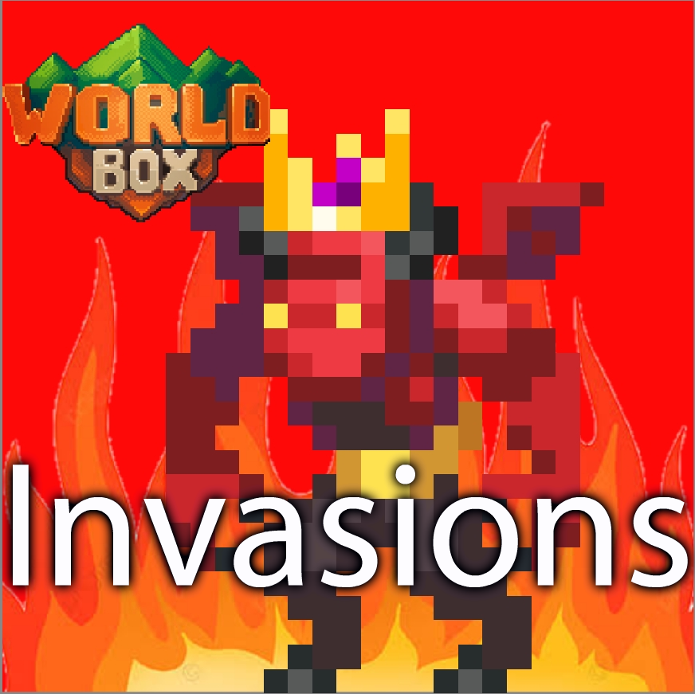

# Invasions

> Bigger invasions for WorldBox: demon, walker and assimilator armies in 9 levels each, dragon attacks and ice weapons.

**[Download Invasions 0.0.3](https://github.com/AgricheX/invasions/releases/latest/download/Invasions.zip)**

| | |
| --- | --- |
| Game | WorldBox 0.22 / 0.23 |
| Mod loader | NCMS |
| Version | 0.0.3 |
| Author | Agriche |

English first, português do Brasil logo abaixo.

---

## English

### What it adds

- Demon invasions in 9 levels: armies of 10 to 20+ demons that raise flame towers.
- Walker invasions in 9 levels, with ice towers.
- Assimilator invasions in 9 levels, with cybercores and UFOs.
- Dragon invasion.
- New weapons: Ice Sword and Ice Staff, which freeze their targets.

### How to install

1. Install NCMS for WorldBox 0.22 / 0.23.
2. Download **Invasions.zip** with the link above.
3. Extract it into the `Mods` folder of your WorldBox installation, so you get `Mods/Invasions/mod.json`.
4. Start the game.

### Help

Questions and bug reports: [Agriche Community on Discord](https://discord.gg/s3EbgNSsJW).

---

## Português (Brasil)

### O que o mod adiciona

- Invasões de demônios em 9 níveis: exércitos de 10 a 20+ demônios que erguem torres de fogo.
- Invasões de walkers em 9 níveis, com torres de gelo.
- Invasões de assimiladores em 9 níveis, com cybercores e OVNIs.
- Invasão de dragão.
- Armas novas: Espada de Gelo e Cajado de Gelo, que congelam os alvos.

### Como instalar

1. Instale o NCMS para o WorldBox 0.22 / 0.23.
2. Baixe o **Invasions.zip** pelo link acima.
3. Extraia na pasta `Mods` do WorldBox, de forma que fique `Mods/Invasions/mod.json`.
4. Abra o jogo.

### Ajuda

Dúvidas e bugs: [Agriche Community no Discord](https://discord.gg/s3EbgNSsJW).

---

WorldBox © Maxim Karpenko. This is a free, fan-made mod, not affiliated with the WorldBox developers.
